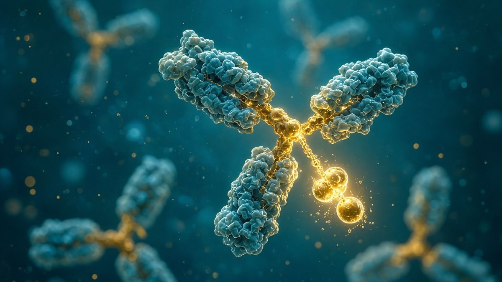
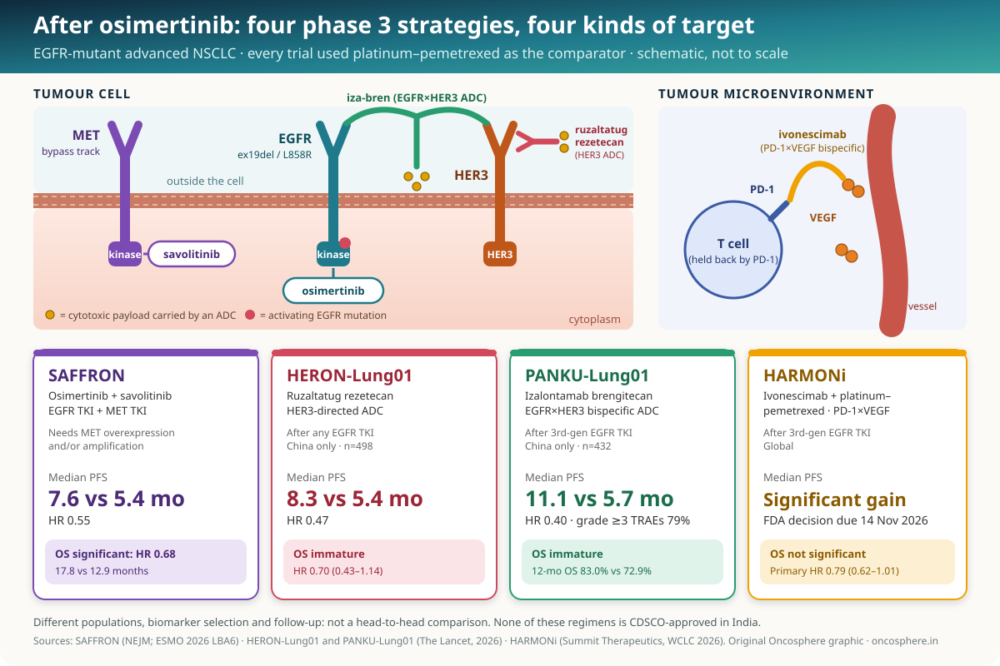
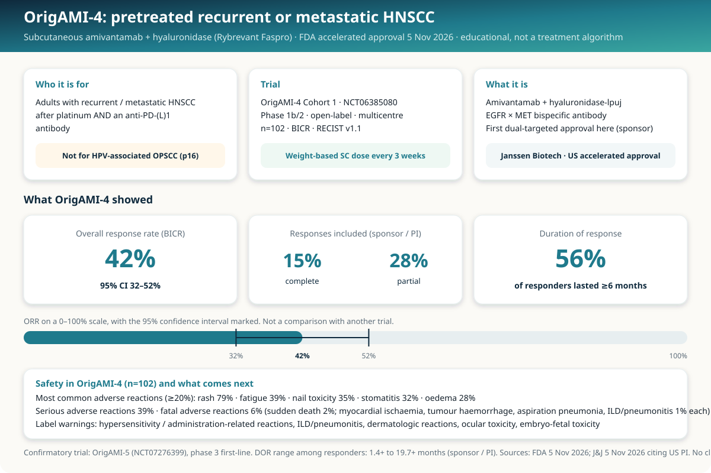
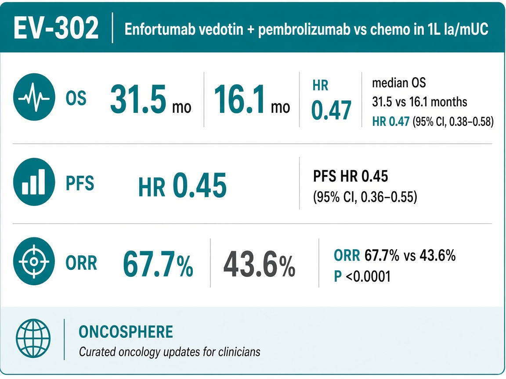
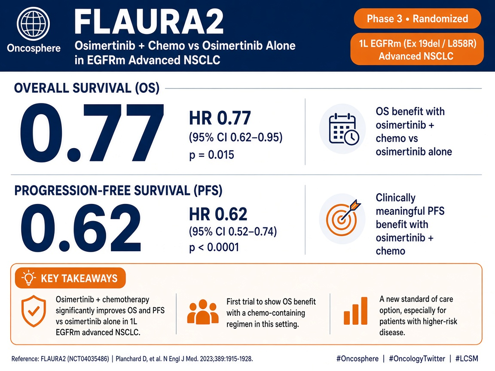
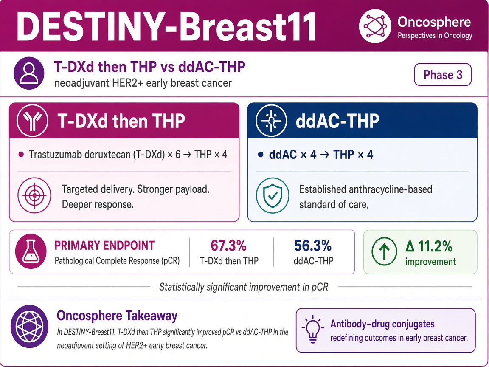
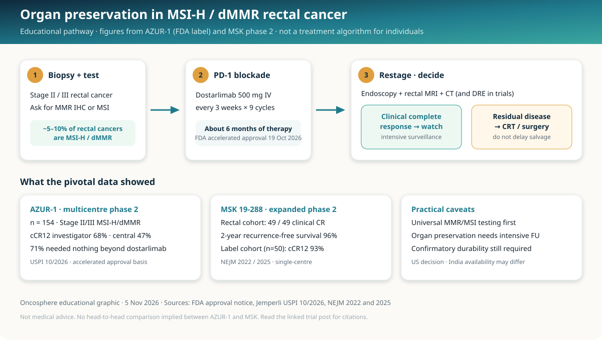

<h1>Oncology infographics gallery</h1>
Illustrations created with Grok Imagine. Click any graphic for the related explainer.

<b>Subtopics:</b> <a href="#precision">Precision oncology</a> · <a href="#pillars">Pillars of systemic therapy</a> · <a href="#adc">Antibody–drug conjugates</a> · <a href="#history">History</a> · <a href="#infographics">Infographics</a>

<a id="precision" href="/first-line-systemic-therapy-in-advanced-cancers/"><figure ><figcaption>Precision oncology: test before you treat.</figcaption></figure></a><a id="pillars" href="/first-line-systemic-therapy-in-advanced-cancers/"><figure ><figcaption>The four pillars of modern systemic therapy (illustrative).</figcaption></figure></a><a id="adc" href="/destiny-breast-11-trial/"><figure ><figcaption>Antibody–drug conjugate (e.g. trastuzumab deruxtecan), schematic.</figcaption></figure></a><a id="history" href="/history/"><figure ><figcaption>From shadows to light: history of cancer treatment.</figcaption></figure></a>

See also: <a href="/history/">History of cancer treatment</a> · <a href="/best-of/">Best of cancer media</a>

<link rel="stylesheet" href="{{ '/assets/gallery-infographics.css' | relative_url }}">
<section class="wrap block">
<h2 id="infographics">Infographics</h2>

<a href="{{ '/lutetium-psma-hormone-sensitive-prostate-cancer-psmaddition/' | relative_url }}"><figure><figcaption>PSMAddition · efficacy and safety · Original Oncosphere chart (20 Nov 2026)</figcaption></figure></a>
<a href="{{ '/atezolizumab-adjuvant-dmmr-colon-cancer-atomic/' | relative_url }}"><figure><figcaption>ATOMIC · disease-free and overall survival · Original Oncosphere chart (19 Nov 2026)</figcaption></figure></a>
<a href="{{ '/atezolizumab-adjuvant-dmmr-colon-cancer-atomic/' | relative_url }}"><figure><figcaption>ATOMIC · adjuvant treatment pathway · Original Oncosphere chart (19 Nov 2026)</figcaption></figure></a>
<a href="{{ '/camizestrant-esr1-ctdna-switch-serena-6/' | relative_url }}"><figure><figcaption>SERENA-6 · progression and survival endpoints · Original Oncosphere chart (18 Nov 2026)</figcaption></figure></a>
<a href="{{ '/camizestrant-esr1-ctdna-switch-serena-6/' | relative_url }}"><figure><figcaption>SERENA-6 · ctDNA-guided switch pathway · Original Oncosphere infographic (18 Nov 2026)</figcaption></figure></a>
<a href="{{ '/talazoparib-enzalutamide-hrr-mhspc-talapro-3/' | relative_url }}"><figure><figcaption>TALAPRO-3 · progression benefit and TALAPRO-2 context · Original Oncosphere chart (17 Nov 2026)</figcaption></figure></a>
<a href="{{ '/talazoparib-enzalutamide-hrr-mhspc-talapro-3/' | relative_url }}"><figure><figcaption>HRR testing in metastatic prostate cancer · Original Oncosphere infographic (17 Nov 2026)</figcaption></figure></a>
<a href="{{ '/relacorilant-platinum-resistant-ovarian-cancer-rosella/' | relative_url }}"><figure><figcaption>ROSELLA · relacorilant in platinum-resistant ovarian cancer · Original Oncosphere chart (16 Nov 2026)</figcaption></figure></a>
<a href="{{ '/nhs-galleri-multi-cancer-early-detection-trial/' | relative_url }}"><figure><figcaption>NHS-Galleri · late-stage cancer by screening round · Original Oncosphere chart (15 Nov 2026)</figcaption></figure></a>
<a href="{{ '/daraxonrasib-pancreatic-cancer-rasolute-302/' | relative_url }}"><figure><figcaption>RASolute 302 · daraxonrasib in previously treated metastatic pancreatic cancer · Original Oncosphere graphic (14 Nov 2026)</figcaption></figure></a>
<a href="/egfr-nsclc-after-osimertinib-2026-phase-3-options/"><figure><figcaption>After osimertinib · MET, HER3, EGFR×HER3 and PD-1×VEGF strategies in EGFR-mutant NSCLC · Original Oncosphere graphic (10 Nov 2026)</figcaption></figure></a>
<a href="/rybrevant-faspro-hnscc-fda-approval/"><figure><figcaption>OrigAMI-4 · Rybrevant Faspro in pretreated HNSCC · Original Oncosphere graphic (8 Nov 2026)</figcaption></figure></a>
<a href="/advanced-bladder-urothelial-cancer/"><figure><figcaption>EV-302: advanced urothelial cancer · Original Oncosphere graphic</figcaption></figure></a>
<a href="/flaura-2-trial/"><figure><figcaption>FLAURA2: EGFR-mutated lung cancer · Original Oncosphere graphic</figcaption></figure></a>
<a href="/destiny-breast-11-trial/"><figure><figcaption>DESTINY-Breast11: HER2-positive early breast cancer · Original Oncosphere graphic</figcaption></figure></a>
<a href="/dostarlimab-organ-preservation-pathway/"><figure><figcaption>Dostarlimab organ-preservation pathway · Original Oncosphere graphic (5 Nov 2026)</figcaption></figure></a>

<a class="tweet-card" href="/dostarlimab-msi-h-rectal-cancer/"><figure>
Oncosphere · Trial brief
<h3>Dostarlimab · dMMR rectal cancer</h3>
<strong>Trial:</strong> Cercek et al., NEJM 2022 · Phase II, single arm

<strong>Arm:</strong> Dostarlimab for 6 months; planned chemoradiotherapy and surgery could be omitted following clinical complete response.

<strong>Key endpoints:</strong> Sustained clinical complete response or pathological complete response; overall response.

12/12 clinical complete responses

Initial report among patients completing treatment with ≥6 months of follow-up. Small early cohort; not a randomized comparison.
<figcaption>Original Oncosphere graphic · Source: Cercek et al., NEJM 2022, doi:10.1056/NEJMoa2201445</figcaption></figure></a>
<a class="tweet-card" href="/first-line-systemic-therapy-in-advanced-cancers/"><figure>
Oncosphere · Evidence map
<h3>First-line systemic therapy · pillars</h3>
<strong>Trials:</strong> Evidence spans tumour-specific randomized trials; this card is a framework, not a single study.

<strong>Arms:</strong> Cytotoxic chemotherapy · endocrine therapy · biomarker-directed targeted therapy · immunotherapy; combinations depend on disease and biomarkers.

<strong>Key endpoints:</strong> Overall survival · progression-free survival · response · quality of life · toxicity.

Test biomarkers first. Match tumour, patient fitness and treatment goals to the relevant published trial.
<figcaption>Original Oncosphere graphic · See linked explainer for individual trials and sources.</figcaption></figure></a>

</section>
